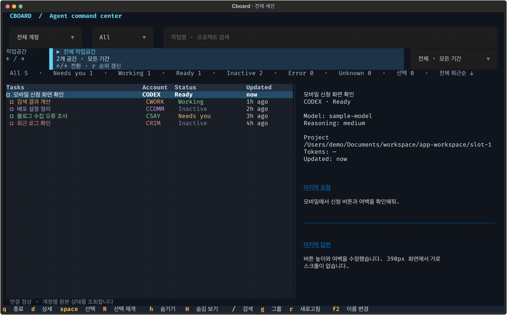

# Cboard

**여러 Codex 계정의 작업을 한 화면에서 찾고, 이어서 실행하는 터미널 보드.**

프로젝트와 슬롯을 오가며 작업할 때, 어디서 무엇을 하던 중이었는지 다시 찾기 위한 도구입니다. 계정별 세션 목록을 모으고 마지막 요청·답변을 보여주며, 선택한 세션을 원래 계정과 폴더에서 재개합니다.

**Windows · Linux · macOS / Python 3.11+** | 현재 버전 `0.2.0`

[빠른 시작](#빠른-시작) · [계정 설정](#계정-설정) · [키보드 조작](#키보드-조작) · [작업공간 탐색](#작업공간-탐색)



> 샘플 데이터로 만든 약 17초 반복 데모입니다. 작업공간 이동 → 상세 확인 → 재개할 세션 선택 흐름을 보여줍니다. [정지 화면 보기](artifacts/screenshots/cboard-160x45.png).

넓은 화면은 목록과 상세를 함께 보여주고, 100열 미만에서는 `d` / `Esc`로 전환합니다.

## 무엇을 할 수 있나요?

| 필요할 때 | Cboard에서 |
| --- | --- |
| 여러 계정에서 진행하던 작업 찾기 | 계정 통합 목록, 상태 필터, 제목·경로 검색 |
| 어느 프로젝트에서 작업했는지 찾기 | `←/→`로 작업공간 이동, 최근 14일 세션 수 순 |
| 작업 맥락 되찾기 | **마지막 요청 → 마지막 답변** 원문 확인 |
| 이전 세션 이어가기 | 원래 계정·폴더로 **새 iTerm2 탭**에서 재개 |
| 다음에 돌아올 작업 기억하기 | `Space`로 선택, 재실행 후 `R`로 함께 재개 |
| 목록 정리하기 | 숨김, 이름 변경, 확인 후 원본 세션 삭제 |

## 빠른 시작

### Windows

1. [Windows 설치 ZIP 다운로드](https://github.com/99duuk/cboard/releases/latest/download/cboard-windows.zip)
2. 압축 해제 후 `START-WINDOWS.cmd` 더블클릭
3. 자동으로 열린 PowerShell에서 `chelp`·`cusage` 실행

- 관리자 권한 불필요, 계정 자동 등록·로그인 없음
- Python·PowerShell·Codex 기존 설치본 우선 재사용, 없는 필수 항목만 준비
- 계정 0개 상태의 정상 안내, 사용자 선택 이름으로 `cnew <이름>` 등록

### Linux

```sh
curl -fsSL https://raw.githubusercontent.com/99duuk/cboard/main/scripts/install-linux.sh | sh
```

- Bash·Zsh 셸 연결, 사용자 범위 설치 및 대화형 실행 시 준비된 셸 자동 열기
- Python 3.11 이상·venv·pip·curl 필요, 배포판 Python/venv 패키지의 사용자 사전 준비
- Git clone·Node·npm 불필요, 기존 Codex 우선 재사용 및 부재 시 공식 고정 버전 준비
- 다운로드 묶음의 SHA-256 검증, 계정 자동 추가·로그인 없음
- [Linux 파일 직접 다운로드](https://github.com/99duuk/cboard/releases/latest/download/cboard-linux.tar.gz) · [다운로드 체크섬](https://github.com/99duuk/cboard/releases/latest/download/SHA256SUMS)

### 배포 범위

| 항목 | 구성 |
| --- | --- |
| 계정 명령 | `cnew`·`clogin`·`clist`·`cuse`·`cdefault`·`crun`·`cusage`·`cdel`·`chelp` |
| 초기 등록부 | 0개, 개인 계정·인증·기록 제외 |
| 설치 의존성 | 실행용 고정 의존성만 포함, pytest·테스트 플러그인 제외 |
| 다운로드 | 런타임 소스만 포함, 스크린샷·테스트·상세 문서·가상환경 제외 |
| 외부 바이너리 | 다운로드 묶음에 미포함, 필요한 경우만 별도 다운로드·무결성 검증 |
| 세션 보드 | TUI 시작 및 계정 관리자 등록부 연결 |
| 현재 한계 | Windows 기존 세션 실시간 Unix 소켓 관찰 미지원, Linux 새 GUI 탭 재개 대신 명령 복사 |

### macOS 보드 단독 설치

먼저 **Codex와 iTerm2가 설치되어 있고**, 사용할 계정의 기존 Codex 서버에 연결할 수 있어야 합니다. Cboard는 서버를 자동 시작하지 않습니다.

```sh
git clone https://github.com/99duuk/cboard.git
cd cboard
sh scripts/install.sh
~/.codex/bin/cboard
```

설치 스크립트가 프로젝트 안에 가상환경을 만들고 `~/.codex/bin/cboard` 실행 명령을 연결합니다. 같은 위치의 다른 실행 파일은 덮어쓰지 않습니다.

`~/.codex/bin`이 PATH에 있다면 이후에는 다음 명령으로 실행하면 됩니다.

```sh
cboard
```

**처음 실행했다면:** 사용할 계정만 [계정 설정](#계정-설정)에 등록하고 `cboard doctor`로 연결 상태를 확인하세요.

## 계정 설정

설정 파일은 `~/.config/cboard/config.toml`입니다. 파일이 없다면 다음 명령으로 기본 설정을 만듭니다.

```sh
cboard init
```

- Windows·Linux 통합 설치: 계정 관리자 등록부 직접 사용, 초기 계정 0개
- Mac 보드 단독 설치의 이전 기본 목록: `CODEX`·`CWORK`·`CCOMM`·`CSAY`·`CRIM`
- 별도 `config.toml`의 명시적 `accounts` 설정 우선, 계정 수 제한 없음

아래는 두 계정만 사용하는 예시입니다.

```toml
schema_version = 1

[[accounts]]
id = "main"
label = "MAIN"
codex_home = "~/.codex"

[[accounts]]
id = "work"
label = "WORK"
codex_home = "~/.codex-work"

# 선택 사항: iTerm2에 실제로 저장된 프로필 이름과 배경색
# iterm_profile = "Work"
# iterm_background = "38220b"
```

- `id`: 저장된 선택과 세션을 구분하는 식별자. 표시 이름만 바꾸려면 `label`을 수정합니다.
- `codex_home`: 해당 계정의 실제 Codex 홈 디렉터리.
- `iterm_profile`: 새 탭에 적용할 iTerm2 프로필. 생략하면 기본 프로필을 사용합니다.
- `iterm_background`: `#` 없는 6자리 RGB. 생략하면 프로필의 배경색을 사용합니다.

프로필 설정은 ‘터미널에서 열기’와 `cboard open`에 적용합니다. 셸에서 쓰는 계정별 프로필을 연결하려면 이 설정에도 같은 값을 넣으세요.

## 키보드 조작

| 키 | 동작 |
| --- | --- |
| `↑` / `↓` | 세션 이동 |
| `←` / `→` | 작업 목록에서 이전/다음 작업공간 |
| `Enter` | 현재 세션의 열기·명령 복사 확인창 |
| `Space` | 나중에 재개할 세션 선택/해제 |
| `R` | 저장된 선택 목록을 확인하고 함께 재개 |
| `h` / `H` | 현재 세션 숨김·복원 / 숨긴 세션 보기 |
| `/` | 제목·작업 경로·계정 이름 검색 |
| `g` | 전체 최근순 → 프로젝트별 → 계정별 보기 |
| `r` | 새로고침 및 작업공간 순위 재계산 |
| `F2` | 세션 이름 변경 — `Enter` 저장, `Esc` 취소 |
| `Delete` | 원본 세션 영구 삭제 확인창 |
| `d` / `Esc` | 상세 / 목록으로 이동 |
| `q` | 종료 |

`R`과 `H`는 대문자입니다. Mac에서 `Delete`는 `Fn+⌫`, F2가 시스템 기능으로 동작하면 `Fn+F2`를 사용하세요.

확인창에서도 화살표로 버튼을 선택하고 `Enter`로 실행할 수 있습니다. `Esc`는 취소하며, 삭제 확인창은 취소 버튼에서 시작합니다.

**삭제는 복구할 수 없으며 하위 에이전트 대화도 함께 삭제합니다.** 목록에서만 감추려면 `h`를 사용하세요. 프로젝트 파일은 삭제하지 않습니다.

## 작업공간 탐색

작업 목록에서 오른쪽 화살표를 누르면 다음 순서로 이동합니다.

```text
전체 → 최근 세션이 가장 많은 작업공간 → 다음 작업공간 → … → 전체
```

현재 작업공간은 청록색 영역에 **이름을 먼저 강조**합니다. 아래에 이동 위치(`1/12`), 최근 세션 수, 경로를 따로 표시합니다. 오른쪽 선택기에서도 원하는 작업공간을 직접 고를 수 있습니다.

| 세션의 작업 위치 | 묶이는 작업공간 |
| --- | --- |
| `~/` | 홈(루트) |
| `~/Desktop/…` | Desktop |
| `~/Downloads/…` | Downloads |
| `…/app-workspace/slot-1` | app-workspace |
| `…/app-workspace/slot-3/frontend` | 같은 app-workspace |
| `~/Documents/workspace/다른프로젝트/…` | 다른프로젝트 |

슬롯·하위 폴더는 같은 workspace에 합산하고, 각 세션 행에 `[slot-3/frontend]` 같은 상대 경로를 표시합니다. 다른 위치의 일반 Git 프로젝트는 저장소 루트로, 나머지는 작업 폴더로 묶습니다. 이름이 같아도 경로가 다르면 별도 작업공간입니다.

- **작업공간 보기:** 마지막 활동이 최근 14일인 세션만 표시하고, 그 안에서는 최근순으로 정렬합니다.
- **전체 보기:** 기간 제한 없이 기존 세션을 최근순으로 표시합니다.
- **순위:** 전체 계정의 숨기지 않은 root 세션 수 기준. 계정·상태·검색 필터와 독립적입니다.
- **갱신:** 자동 조회 중 순서는 유지하고 `r`에서 다시 정렬합니다. 마지막 작업공간은 재실행 때 복원합니다.

검색창의 좌우 키는 글자 이동에 사용합니다. 작업공간을 넘기려면 작업 목록에 포커스를 두세요.

## 쉬었다 돌아왔을 때

1. 작업공간이나 검색으로 이전 세션을 찾습니다.
2. 상세의 마지막 요청·답변으로 작업 맥락을 확인합니다.
3. `Enter` → **터미널에서 열기**를 선택하면 원래 계정과 폴더에서 재개합니다.

여러 작업을 기억하려면 끝낸 세션은 `h`로 숨기고, 이어갈 세션은 `Space`로 선택하세요. 종료해도 선택은 남고, 다음 실행에서 `R`로 재개할 수 있습니다. 화면 필터 밖의 선택도 유지합니다.

새 탭은 같은 원본 세션에 연결합니다. 이미 열린 탭이 있어도 새 탭을 만들며, 세션을 복제하거나 새 프롬프트를 보내지는 않습니다.

## CLI로도 사용하기

```sh
cboard doctor                             # 계정 연결 확인
cboard list --json                        # 세션 목록 JSON
cboard list --account work --status Ready # 특정 계정·상태
cboard detail work/THREAD_ID              # 마지막 대화 확인
cboard open work/THREAD_ID                # 새 iTerm2 탭에서 재개
cboard open work/THREAD_ID --copy         # 재개 명령 출력
```

`work`는 설정의 `id`, `THREAD_ID`는 실제 세션 ID로 바꾸세요. CLI의 `--copy`는 명령을 출력하고, 화면의 ‘명령 복사’는 클립보드에 복사합니다. 별도 설정 파일은 `cboard --config /path/to/config.toml`로 지정할 수 있습니다.

## 저장 위치와 현재 한계

| 항목 | 기본 저장 위치 |
| --- | --- |
| 계정 설정 | `~/.config/cboard/config.toml` |
| 선택·숨김·필터 | `~/.local/share/cboard/state.json` |
| 본문을 제외한 세션 metadata 캐시 | `~/.cache/cboard/` |

Cboard는 기존 계정별 Codex 서버에서 목록·상태·본문을 읽습니다. 상태 조회는 기본 3초, 전체 목록 갱신은 15초입니다. 연결이 끊기면 마지막 목록에 오래된 정보임을 표시합니다.

- **검증 환경:** macOS/iTerm2, Codex CLI `0.162.1`. 다른 버전·원격·daemon 없는 세션의 실시간 상태는 검증하지 않았습니다.
- **미저장 세션:** 첫 사용자 메시지 전의 빈 세션은 재개할 수 없습니다. `미저장`으로 표시하며, 대화가 저장된 뒤 다시 재개할 수 있습니다.
- **iTerm2 연동:** 내장 AppleScript를 사용합니다. 앱 제어가 차단되면 명령 복사를 사용하세요. 자동화 실패 후에는 해당 Cboard 실행의 추가 탭 열기를 중단합니다.
- **토큰 정보:** 입력·출력 토큰 세부 수치는 아직 `—`로 표시합니다.
- **삭제:** Ready/Inactive는 허용하고, 실행 중·승인 대기·상태 확인 불가는 차단합니다. 응답이 끊기면 자동 재시도하지 않습니다. 실행 직전 조회와 삭제를 원자적으로 묶는 기능은 아닙니다.

세부 동작과 실제 확인 범위는 [검증 기록](docs/VERIFICATION.md)에 정리했습니다.

## 개발·검증

설치 후 저장소 루트에서 실행합니다.

```sh
.venv/bin/python -m pytest -q
.venv/bin/python scripts/visual_qa.py
.venv/bin/python scripts/benchmark.py --output /tmp/cboard-performance.json
```

README GIF를 다시 만들려면 `brew install ffmpeg librsvg` 후 `.venv/bin/python scripts/demo_gif.py`를 실행합니다. 실제 계정 설정·세션·터미널을 사용하지 않고 샘플 데이터로 화면을 생성합니다. 이 도구들은 GIF 제작용이며 Cboard 실행에는 필요하지 않습니다.

현재 **134개 자동 테스트 통과**. 5계정·2,000행 합성 데이터의 변경 없는 반복 갱신 중앙값은 최적화 전 약 303ms에서 약 22ms로 줄었습니다. 이는 headless UI 5회 측정이며 전체 사용자 체감 속도나 메모리 감소율을 보장하는 수치는 아닙니다.

| 바꾸려는 부분 | 위치 |
| --- | --- |
| 계정·설정 | `src/cboard/config.py` |
| Codex 서버 조회 | `src/cboard/sources/` |
| 작업공간 경로 규칙 | `src/cboard/workspaces.py` |
| 목록 통합·필터 | `src/cboard/services.py` |
| 터미널 UI | `src/cboard/ui/` |
| 재개 명령·iTerm2 연동 | `src/cboard/terminals/` |
| 원본 이름 변경·삭제 | `src/cboard/renaming.py`, `src/cboard/deletion.py` |

- [제품·구조 명세](docs/SPEC.md)
- [구현 계획과 회귀 시나리오](docs/PLAN.md)
- [API 사전 조사](docs/DISCOVERY.md)
- [실행 검증과 성능 측정](docs/VERIFICATION.md)

가상환경·인증 파일·실제 세션 기록·로컬 설정과 개인 작업공간 집계 원자료는 Git에 포함하지 않습니다. 화면 자료는 샘플 데이터로 생성합니다.

## 계정 관리자 통합

- 계정 등록·선택·사용량·공통 환경 관리 소스: [`codex-environment/`](codex-environment/README.md)
- 저장소 구성: `src/cboard/`의 세션 보드 및 `codex-environment/`의 독립 계정 관리자
- 기본 관리자 구성: 등록 계정 0개, 개인 인증·공통 스킬·설정 제외
- 현재 운영 지원: macOS·zsh, Windows/Linux 이식의 G0 선행 검증 진행 중
- Windows 설치본의 `cboard` 명령: 계정 관리자 등록부의 직접 조회, 별도 Cboard `accounts` 설정 존재 시 해당 설정 우선
- 기존 Mac 설치의 자동 이전 없음, 새 설치 시 아래 관리자 설치 명령 사용

```sh
./codex-environment/bin/cenv install --dry-run
./codex-environment/bin/cenv install
# 새 터미널에서 실행
cnew personal
clist
```

- 기존 계정 홈 재사용: `cenv account import personal --home ~/.codex-existing`
- Mac Cboard 연결: 위 계정 홈을 `~/.config/cboard/config.toml`의 `codex_home`으로 지정
- 각 모듈의 설치·테스트·의존성 경계 유지, Cboard 설치만으로 관리자 설정 변경 없음
- 크로스 플랫폼 명세: [SPEC-CROSS-PLATFORM.md](codex-environment/SPEC-CROSS-PLATFORM.md)
- G0 구현·검증 상태: [G0-RESULTS.md](codex-environment/docs/G0-RESULTS.md)

## Windows 명령 설치

- 전달 파일: `dist/cboard-windows-install-r2.zip`
- 실행: 압축 해제 후 `START-WINDOWS.cmd` 더블클릭
- 설치 결과: 새 PowerShell의 `cusage`·`cnew`·`cdel` 등 계정 관리 명령 및 Cboard 시작 명령
- 자동 계정 등록·로그인 없음
- Windows의 기존 세션 실시간 관찰: Unix 소켓 전송 의존에 따른 미지원
- 상세 설치·검증 범위: [Windows 설치 안내](scripts/windows/README.md)
