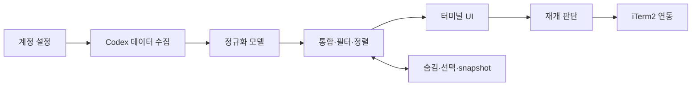

# Cboard 제품·구조 명세

- 버전: 구현 v0.1.0
- 작성일: 2026-10-14
- 상태: 구현 및 로컬 검증 완료. 상세 결과는 [VERIFICATION.md](VERIFICATION.md).
- 사용자 요구: 계정별 Agent Command Center 통합, 작은 범위, 확장·수정이 쉬운 구조.
- 기준 화면: 사용자가 제공한 Agent Command Center 스크린샷. 프로젝트별 목록, 상태 필터, 오른쪽 상세 패널을 유지한다.

## 1. 목표와 범위

`cboard` 한 번으로 모든 계정의 대화를 보고, 마지막 대화로 작업 맥락을 되찾으며, 선택한 대화를 원래 계정·폴더에서 재개한다.

| 포함 | 이번 버전에서 제외 |
| --- | --- |
| 계정 통합, 프로젝트 그룹, 상태·계정 필터, 검색 | 새 터미널 앱, tmux 도입, 웹 서버 |
| 제목·모델·reasoning·마지막 메시지·요청 조회 | 별도 작업 생성·완료·담당자 관리 |
| 숨기기·숨김 해제, 단일·선택 다중 재개 | AI 자동 요약, 계정 자동 전환·사용량 배분 |
| 확인 후 단일 원본 대화 영구 삭제 | 다중 대화 일괄 삭제, 프로젝트 파일 삭제 |
| 기존 대화와 상태의 읽기, 선택 항목 기억 | Codex 실행 명령 래핑, hook 설치, 상주 수집 데몬 |
| 연결 장애·부분 조회·확인 불가 표시 | 모든 기존 탭의 자동 추적, 창 배치 복원, 프로세스 메모리 복원 |

초기 사용 때 7개 중 5개를 선택하거나 2개를 숨기는 동작은 허용한다. 선택한 항목은 기억한다. 한 번도 선택하지 않은 과거 탭 중 어떤 5개가 복구 대상이었는지 자동 판정하는 것은 이 버전의 보장이 아니다.

## 2. 사용자 동작

### F01. 통합 목록

- 설정에 등록된 모든 계정을 각각 읽고 한 화면에 합친다.
- 행: 선택 표시, 작업명, 계정, 상태, 최근 활동 시각.
- Tasks 영역은 세로 스크롤만 제공한다. 표시 폭에서 세로 스크롤바·열별 padding을 제외해 열 너비를 계산하며, 긴 제목은 행 폭 안에서 표시한다. 화면 크기 변경 후 실제 Tasks viewport를 기준으로 다시 계산한다.
- 기본 보기는 그룹 없이 전체 최근순이다. 상태·계정·프로젝트보다 최근 활동 시각을 우선한다. 프로젝트별 보기에서는 같은 경로의 여러 계정 대화를 같은 그룹에서 계정 표시로 구분한다.
- 디렉터리 basename만으로 서로 다른 프로젝트를 합치지 않는다. 접근 가능한 경로는 정규화하고 원래 cwd도 보존한다. 다른 worktree 경로는 별도 그룹이다.
- 기본 목록은 Codex API의 비보관 interactive 대화. CLI와 앱/IDE에서 시작한 대화를 함께 포함한다.
- subagent는 기본 목록에서 제외한다. 관련 메타데이터는 보존해 나중에 하위 대화 표시를 추가할 수 있게 한다.
- 첫 화면은 빠른 계정부터 보여주고 나머지는 뒤이어 합친다. 정렬은 활동 시각 내림차순 → 안정적인 고유 키 순서. 갱신 후에도 동일한 기준으로 정렬하며 현재 커서는 고유 키로 유지한다. 그룹 보기의 항목도 최근순이며 그룹 순서는 각 그룹의 가장 최근 활동 시각 내림차순이다. 그룹 간에는 전체 날짜 순서를 보장하지 않으므로 화면에 보기 모드를 명시한다.
- 첫 실행은 `All`, 이후 마지막 필터를 복원한다. 계정 개수나 이름을 화면 코드에 하드코딩하지 않는다.

### F02. 필터·검색·개수

- 상태: `All / Needs you / Working / Ready / Inactive / Error / Unknown`.
- 계정: 전체 또는 설정된 계정 선택. `g`로 전체 최근순/프로젝트별/계정별 보기를 전환하며 마지막 보기를 저장한다.
- 검색 대상: 제목, 프로젝트 경로, 계정 이름. 모든 대화 본문을 검색하지 않는다.
- 필터와 그룹 전환 중에도 선택은 `(account_id, thread_id)`로 유지한다.
- 개수는 현재 계정·검색·숨김 조건에 맞는 항목을 기준으로 계산한다. 아직 읽는 중인 계정은 `조회 중`, 실패한 계정은 `일부 계정 조회 불가`를 함께 표시한다.
- 페이지 첫 100개를 전체 개수로 표현하지 않는다. 페이지 조회가 끝나기 전에는 `불러온 N개`로 표시한다.

### F03. 상세 패널

- 작업명, 계정, 원본 상태, 프로젝트 경로, 모델, reasoning effort, 활동 시각.
- 위에서부터 마지막 사용자 요청 → 마지막 assistant 답변 순서로 원문을 표시한다. assistant의 final 메시지를 우선하고, 없으면 commentary임을 명시한다.
- `thread.preview`는 첫 요청인 경우가 있으므로 마지막 요청으로 표시하지 않는다.
- 사용자 메시지의 이미지·비텍스트 항목은 첨부 여부로 표시한다. 시스템·개발자 메시지나 reasoning 항목을 사용자 대화로 표시하지 않는다.
- 상세는 선택한 대화만 지연 조회한다. 선택 A의 느린 응답이 나중에 선택한 B의 패널을 덮어쓰지 않도록 요청 세대를 확인한다.
- 모델/토큰 등 없는 값은 `—`. 입력·출력 토큰은 정확한 출처를 확보한 경우만 표시한다. 토큰 보충은 목록·상세의 출시를 막지 않는다.
- 최근 항목 조회 한도에 걸리면 `이전 메시지 더 보기`를 제공하며, 읽지 못한 메시지를 없다고 단정하지 않는다.

### F04. 숨기기

- `h`: 현재 행을 Cboard 목록에서 숨긴다. `H`: 숨긴 항목 보기. 숨긴 행에서 `h`로 복원한다. 다른 복구 선택은 보존한다.
- 숨김은 Cboard 개인 설정이며 Codex archive/delete를 호출하지 않는다.
- 숨기는 항목은 저장된 복구 선택에서도 제거한다. 숨김 해제만으로 복구 선택에 다시 넣지 않는다.
- 활성 대화를 숨겨도 실행을 중단하지 않는다.
- Inactive나 프로세스 종료를 작업 완료로 자동 판정하지 않는다.

### F05. 대화 열기·재개

- `Enter`: 한 항목 열기. `Space`: 복수 선택. `R`: 선택한 항목의 재개 목록 표시 및 실행.
- 재개 확인창은 첫 사용 가능한 버튼에 초기 포커스를 두고, ←/↑는 이전 버튼, →/↓는 다음 버튼으로 순환한다. 비활성 버튼은 건너뛰며 Enter는 포커스된 버튼을 한 번 실행한다. Tab·마우스·Esc 취소도 유지한다.
- 실행 직전 계정·대화·cwd를 다시 확인하고, 숨김·보관·재개 불가 항목과 실패 항목을 분리한다.
- 재개 단위는 정확한 thread ID다. `--last`, 이름, 경로만으로 대화를 선택하지 않는다. 같은 session tree의 `sessionId`도 재개 키로 사용하지 않는다.
- 실행 환경에 해당 계정의 `CODEX_HOME`을 명시하고, 검증된 Codex 실행 파일에 `-C <cwd> resume <thread_id>`를 전달한다. 후속 프롬프트는 자동 전송하지 않는다.
- ‘터미널에서 열기’는 매번 새 iTerm2 탭을 생성해 정확한 원본 thread ID를 재개한다. 같은 대화의 기존 탭이 있어도 이동·재사용하지 않는다. iTerm2 창이 없으면 새 창을 만든다. 대화를 fork하거나 thread ID를 새로 만들지는 않는다.
- 계정별 optional `iterm_profile`로 새 탭/새 창을 생성한다. 미설정이면 기본 프로필을 사용한다. optional `iterm_background`는 6자리 RGB이며 생성된 탭의 재개 실행 전에 적용한다. 프로필 이름은 제어문자 없는 비어 있지 않은 문자열로 검증해 AppleScript argv로 전달한다. 배경색은 hex만 허용한다. UI 코드에 계정별 프로필·색 매핑을 넣지 않는다.
- 기존 탭의 경로·제목을 조회해 연결 위치를 추정하지 않는다. 확인창에서 `재개 명령 복사 / 새 탭에서 연결`을 선택한다.
- API의 loaded 여부는 열린 탭의 존재 증명이 아니다. 앱 대화나 백그라운드 작업일 수 있다.
- loaded/Ready·ephemeral=false도 저장된 대화의 증명이 아니다. 첫 사용자 메시지 전의 unmaterialized 세션은 목록에 미저장으로 표시하고, 재개와 재개 명령 복사를 허용하지 않는다. 처음 root metadata를 읽거나 재개·명령 복사를 실행하기 직전에 thread/turns/list summary로 저장 상태를 확인한다. 성공한 확인은 실행 중 반복 polling에서 재사용하지만 목록·디스크 캐시만으로 확인을 생략하지 않는다. 서버의 not materialized/before first user message 응답은 `persisted=false`로 정규화하며, 실패한 확인은 재사용하지 않아 첫 메시지 후 다음 조회에서 복구 가능한 상태로 갱신한다.
- 여러 항목을 열 때 계정별 cwd/환경이 서로 섞이지 않게 각 실행을 독립적으로 구성한다. 실행 중 중복 입력은 busy guard로 막고 iTerm2 자동화는 공용 잠금으로 직렬화한다. 완료 후 다시 명시적으로 열면 새 탭을 생성한다.
- 경로·계정 등 개별 항목의 실패 시 성공한 탭은 유지하고 다른 항목은 계속 처리한다. 존재하지 않는 cwd를 홈 디렉터리로 몰래 바꾸지 않는다.
- iTerm2 자동화의 timeout·오류·확인할 수 없는 생성 결과는 `TerminalUnavailable`로 구분한다. 해당 실패 이후 남은 항목의 자동 열기를 즉시 중단하고, 같은 Cboard 실행에서 자동 열기를 비활성화한다. 선택·조회·명령 복사는 유지한다. 대기 중이던 같은 launcher의 요청도 더 이상 AppleEvent를 보내지 않는다.
- AppleEvent 응답 제한은 10초, 외부 osascript 프로세스 제한은 20초다. 결과를 확인하지 못한 탭은 이미 생성됐을 수 있으므로 자동 재시도·자동 닫기를 하지 않는다. 실패 차단은 해당 Cboard 실행 범위이며, iTerm2 상태 확인 후 Cboard 재실행으로 다시 시도한다. 별도 실행끼리는 자동화 요청을 직렬화하지만 차단 상태는 공유하지 않는다.
- iTerm2 연동을 사용할 수 없어도 조회 화면은 동작한다. 재개 명령을 표시·복사할 수 있다.

### F06. 선택 복원과 앱 종료

- 사용자의 선택 목록을 Cboard 로컬 설정에 저장한다. 선택·숨김 변경 시 저장하므로 종료 이벤트에 의존하지 않는다.
- 다시 켰을 때 저장한 선택을 복원하되, 앱 시작만으로 새 탭을 열지 않는다.
- `R`에서 복구할 목록과 개수를 확인할 수 있게 한다. 화면 필터 밖의 선택도 개수와 목록에 드러낸다.
- 창·프로세스가 사라져도 Codex가 보관하는 대화 기록으로 재개한다. 실행 중이던 명령의 재시작은 보장하지 않는다.

### F07. 원본 대화 삭제

- `Delete`(Mac Fn+⌫)는 현재 행 한 개의 삭제 확인창을 연다. 다중 선택을 삭제 대상으로 자동 사용하지 않는다. `h`의 로컬 숨김과 구분한다.
- 계정 이름, 대화 제목, 프로젝트 경로, 계정+대화 ID와 하위 대화 개수를 표시한다. 확인어 입력은 요구하지 않는다. 초기 포커스는 취소 버튼이며 Enter를 바로 누르면 취소한다. ←/↑ 및 →/↓로 두 버튼을 순환하고 Enter로 현재 버튼을 한 번 실행한다. ‘영구 삭제’를 선택하거나 클릭한 경우만 삭제 요청을 보낸다. 취소 또는 Esc는 쓰기 요청을 보내지 않는다.
- 공식 `thread/delete`로 원본 대화와 생성된 하위 에이전트 대화를 영구 삭제한다. 복구 불가를 확인창에 표시하며 프로젝트 파일을 직접 삭제하지 않는다.
- 조회 RPC는 기존 읽기 allowlist를 유지한다. 삭제는 별도의 `deletion.py` 서비스와 전용 연결의 `delete_thread`로만 요청한다. 계정 설정의 정확한 socket과 thread ID를 사용한다. UI에서는 `SessionDeleter` Protocol로 주입한다.
- 저장된 최상위 대화만 허용한다. root의 원본 상태가 `idle`(Ready) 또는 `notLoaded`(Inactive)이면 허용하고 Working·Needs you·Error·Unknown은 거절한다. 로드됐다는 이유만으로 삭제를 막지 않는다. 서버 연결을 확인할 수 없는 stale 행도 거절한다.
- 비보관·보관 하위 대화를 모든 현재 sourceKind에 대해 끝까지 조회하고, 로드된 대화의 부모 관계도 검사해 저장 목록에 없는 임시 하위 대화를 확인한다. 삭제 범위에 있는 대화가 실제 작업 중·승인 대기·상태/부모 관계 확인 불가이면 삭제를 중단한다. 로드된 대화는 별도 thread/read로 최신 상태를 확인하며 관련된 부모 경로 전체에도 같은 검사를 적용한다. idle 하위 대화는 허용하되 ephemeral 하위 대화는 거절한다.
- 실행 직전에 계정·대화·제목·경로·하위 대상 집합·로드 상태를 재검사한다. 확인창과 대상이 달라졌으면 삭제하지 않고 확인창을 다시 열도록 안내한다. 읽기와 삭제 사이의 다른 클라이언트 재연결을 원자적으로 차단하지는 못한다.
- 성공 응답을 받은 뒤 삭제된 계정+ID를 로컬 선택·숨김에서 제거하고 전체 목록을 갱신한다. 다른 계정의 같은 ID, 필터와 보기 모드는 보존한다. 선택 저장이 실패하면 원본 삭제는 완료됐다고 별도로 안내한다.
- 응답 유실·timeout에는 자동 재시도하지 않고 결과 불명과 새로고침을 안내한다. 새 목록 조회가 실패하면 기존 metadata가 stale로 남을 수 있다. 실제 사용자 대화에 삭제 요청을 보내는 시험은 하지 않는다.

### F08. 세션 이름 변경

- 현재 행에서 F2로 계정·대화 ID와 현재 이름이 있는 입력창을 연다. 현재 이름을 선택해 바로 대체할 수 있게 입력에 초기 포커스를 둔다. Enter 또는 저장 버튼은 실행, Esc 또는 취소 버튼은 쓰기 없이 닫는다.
- trim 후 비어 있지 않은 한 줄만 허용한다. 한국어·emoji·일반 기호는 보존하고 제어 문자는 거절한다.
- CLI에서 주입한 `SessionRenamer`가 정확한 계정 socket과 thread ID에 `thread/name/set`을 한 번 요청한다. 원본 조회 allowlist를 확장하지 않으며 별도 연결의 명시적 쓰기 메서드를 사용한다. thread/start·resume·turn/start는 호출하지 않는다.
- 저장된 Inactive·Ready·Working 대화의 이름 변경을 허용한다. 임시 대화와 대화 ID 불일치, 계정 연결을 확인할 수 없는 stale 행은 거절한다.
- 응답 후 thread/read로 이름을 확인하고 목록·상세를 갱신한다. 활동 시각이 바뀌지 않아도 이름 변경은 상세 갱신 대상으로 취급한다. 선택·숨김·대화 ID는 변경하지 않는다. 응답이 끊기면 새로고침하되 자동 재시도하지 않는다.

### F10. 최근 작업공간 탐색

- 작업 목록에 포커스가 있으면 ←/→로 전체 → 최근 14일 세션이 많은 작업공간 순서를 순환한다. 선택기로도 직접 이동한다. 검색창의 커서 이동, 계정/상태 선택 및 재개/삭제 확인창의 버튼 이동을 가로채지 않는다.
- 현재 작업공간을 기존 3줄 높이 안의 별도 강조 영역에 고정 표시한다. 첫 줄은 이름, 둘째 줄은 이동 위치/전체 작업공간 수·최근 세션 수, 셋째 줄은 경로다. 전체 보기와 0개인 선택 그룹도 명시한다. 이름과 경로를 분리하고 한 줄 넘침은 생략 표시하며 전체 경로는 tooltip에서 확인한다. 선택기 옵션도 이름을 먼저 표시한다. 내용이 같으면 강조 영역을 다시 갱신하지 않는다.
- 전체는 기존 전체 기간 목록. 작업공간을 선택하면 마지막 활동 시각이 현재 시각 - 14일 이상인 root 대화만 표시한다. 계정/상태/검색/숨김 필터를 함께 적용한다. 새 그룹으로 이동하면 첫 행에서 시작한다.
- 집계는 전체 계정의 root 세션 수이며 계정/상태/검색 조건과 독립적이다. 기본 숨김은 제외하고 H 보기에서는 포함한다. 같은 ID의 다른 계정은 각 세션으로 센다. count 내림차순, 동률은 전체 그룹 경로 순서로 안정화한다.
- 홈 cwd 자체는 홈(루트). Desktop/Downloads와 그 하위는 각각 해당 디렉터리로 합친다. ~/Documents/workspace 바로 아래 프로젝트와 모든 하위 폴더는 한 그룹이다. 그 밖의 경로는 가장 가까운 *-workspace 상위 폴더, 가장 가까운 .git 저장소 루트, 실제 작업 폴더 순서로 잡는다. cwd가 없으면 작업 경로 없음으로 표시한다. 그룹 키는 절대 경로이며 동명 폴더의 다른 경로는 구분한다.
- bottling-workspace/slot-3/frontend와 bottling-workspace/slot-1은 bottling-workspace 그룹 하나에 들어간다. 선택한 그룹의 행 제목 앞에 slot-3/frontend 등 상대 경로를 표시하며, g의 프로젝트 보기에서도 슬롯별 그룹으로 다시 나누지 않는다.
- 최초 전체 조회 및 r에서 순위를 계산한다. 자동 polling 중 기존 그룹의 순서는 유지하고 새 그룹은 뒤에 추가한다. 선택한 그룹이 0개가 되면 0개·빈 목록으로 유지하며 다른 그룹으로 자동 이동하지 않는다. 마지막 선택은 기존 filters에 workspace 키로 저장하고 다른 선택·숨김을 보존한다.
- 경로 규칙은 workspaces.py, 집계/필터는 Board, 키 조작/선택기는 UI에 둔다. 경로 판단은 최대 2,048개의 cwd를 캐시하고 r에서 재검사한다. 변경 없는 polling은 기존 화면/캐시 쓰기 최적화를 유지한다. 원본 세션이나 프로젝트 파일을 변경하지 않는다.

### 화면 구성안

```text
Agent command center        계정: 전체       그룹: 프로젝트
All 716  Needs you 0  Working 1  Ready 5  Inactive 710

Tasks                          Account  Status    Updated │ Task details
~/project-a                                              │ 제목 / 계정 / 상태
  □ 화면 개선                  CWORK    Ready       15h  │ 모델 / reasoning
  □ 오류 조사                  CCOMM    Working     now  │ 프로젝트
~/project-b                                              │ 마지막 요청
  □ 배포 설정                  CSAY     Inactive      1d │ 마지막 답변
                                                         │
Enter 열기  Space 선택  R 선택 재개  h 숨기기  / 검색  q 종료
```

숫자는 조사 시점의 예시다. 상태와 개수는 실행할 때 다시 계산한다. 넓은 화면은 좌우 패널, 100열 미만은 목록/상세 전환 방식으로 한다. 색만으로 계정·상태를 구분하지 않는다. 한국어·긴 경로·Markdown·크기 변경을 검증한다.

## 3. 데이터 취득 계약

### 3.1 주 경로: 계정별 기존 Codex 서버

조사에서 5개 계정 모두 아래 소켓에 연결해 목록·상태·대화 이력을 읽었다. 실제 결과는 [사전 조사](DISCOVERY.md)를 따른다.

```text
<CODEX_HOME>/app-server-control/app-server-control.sock
  → WebSocket over Unix socket
  → initialize / initialized
  → thread/list, thread/loaded/list, thread/read
  → thread/turns/list, 지원 확인 후 thread/items/list
```

연결은 계정별로 독립적이다. `initialize.capabilities.experimentalApi=true`를 사용하는 경우에도 조회 메서드만 허용한다. 현재 설치 버전의 JSON Schema와 실제 응답을 기준으로 기능 지원을 결정한다.

- `thread/list`: limit 100, sortKey updated_at, archived false, useStateDbOnly true. 계정별 nextCursor를 끝까지 처리한다.
- `sourceKinds`는 초기에는 생략하여 interactive 기본 범위를 사용한다. `cli`만 지정하지 않는다.
- 로드된 ID 목록과 저장 목록을 합치고, 목록에 없지만 로드된 ID는 metadata-only `thread/read`로 확인한다. 부모/출처를 확인해 하위 에이전트를 제외한다.
- `thread/read(includeTurns=false)`로 모델·상태 등의 metadata를 읽는다.
- 상세의 우선 경로는 `thread/items/list`, 최신순 50개 단위, 자동 탐색 최대 3페이지. 지원하지 않으면 `thread/turns/list`의 최근 turn 페이지를 사용한다. 한 번에 전체 대화 이력을 읽는 경로는 기본으로 사용하지 않는다.
- `thread/resume`는 조회 수단으로 사용하지 않는다. 읽기 화면은 thread/start, turn/start, archive, delete, 설정 쓰기, 승인 응답도 호출하지 않는다.
- 원래 계정에 연결해야 실시간 상태를 볼 수 있다. 조회용으로 새 독립 서버를 띄워 기존 대화의 Inactive 여부를 판정하지 않는다.

### 3.2 상태 변환

아래는 원본 상태를 표시용 상태로 바꾸는 제안이다. 실제 Native Command Center와의 비교 검증은 구현 1단계에서 수행한다.

| API 상태 | 표시 | 의미 |
| --- | --- | --- |
| active + waitingOnApproval / waitingOnUserInput | Needs you | 사용자 응답 필요 |
| active + 대기 flag 없음 | Working | 실행 중 |
| idle | Ready | 원래 서버에 로드돼 있으며 현재 turn을 실행하지 않음 |
| notLoaded | Inactive | 연결한 원래 서버에서 로드되지 않음. 작업 완료를 뜻하지 않음 |
| systemError | Error | 서버가 보고한 오류 |
| 알 수 없는 상태, 조회 실패, 다른 실행 서버 여부 불명 | Unknown | 원본 상태를 확정할 수 없음 |

`runtime_status`와 데이터의 `freshness`는 별도 필드다. 이전 Working 응답만 남았으면 `Working · 마지막 확인 30초 전`처럼 오래된 표시를 붙인다. 통신 실패를 Inactive로 덮어쓰지 않는다. 낯선 active flag는 원문을 보존하고 Unknown으로 처리한다.

### 3.3 갱신과 장애

- 최초 전체 목록은 계정별 병렬 페이지 조회. UI는 페이지 단위로 반영한다.
- 로드된 ID·상태 확인은 기본 3초, 목록 재조정은 15초. 전체 목록을 매 3초마다 다시 읽지 않는다.
- 상태 변경 알림은 수신되면 반영하지만, 조회 전용 연결이 모든 알림을 받는다고 가정하지 않는다. polling이 기본 보장 경로다.
- 연결당 수신 루프는 하나. 응답은 request ID로 연결하고 알림은 별도로 처리한다. 재연결 전 응답이 새 연결의 화면을 갱신하지 않도록 connection generation을 둔다.
- 요청 timeout 5초, 계정당 동시 요청 최대 2개. 재연결은 1/2/5/10/30초 상한의 지연을 사용한다. 숫자는 설정 가능한 운영값이며 성능 검증 후 조정한다.
- 한 계정의 오류는 다른 계정과 UI를 중단시키지 않는다. 갱신 중 검색·선택·스크롤을 유지한다.
- F09 성능: 표시되는 행·순서·폭·그룹·상대 시각·선택·숨김·stale가 같으면 DataTable을 다시 만들지 않는다. 상세의 이름·경로·모델·원본 상태 변경은 목록 변경과 별도로 반영한다. 통합 인덱스는 계정 snapshot의 task tuple이 바뀔 때 갱신한다.
- 매번 확인한 시각은 보존하되 시각만 달라진 3초 polling에서는 metadata 캐시를 쓰지 않는다. 실제 상태·이름·저장 여부 변경, 연결 복구 및 저장 실패 재시도에서는 즉시 쓰며 15초 전체 갱신은 항상 조회 시각을 저장한다. polling 주기는 성능 개선 때문에 늦추지 않는다.
- 서버를 사용할 수 없으면 마지막 metadata snapshot을 읽고 조회 시각을 표시한다. 저장된 본문 전체는 복제하지 않는다.
- 첫 실행부터 서버가 없고 snapshot도 없으면 해당 계정을 `연결 불가`로 표시한다. 서버 자동 시작·재시작은 하지 않는다.

## 4. 수정·확장이 쉬운 구조

### 4.1 기술 선택

Python 3.11+와 asyncio를 사용한다. 화면은 Textual, 기존 소켓 연결은 websockets, iTerm2 제어는 내장 AppleScript를 사용한다. 현재 환경의 Python API가 비활성이고 내장 연동은 실제 탭 재개까지 검증돼 이 경로를 선택했다. 의존성은 requirements.lock으로 고정하고 프로젝트 전용 가상환경에 설치한다.

외부 라이브러리는 화면·프로토콜·터미널 제어에 맡긴다. 환경설정은 tomllib, 경로·로컬 저장은 표준 라이브러리로 처리한다. 별도의 서비스 프레임워크나 범용 플러그인 로더는 도입하지 않는다.

### 4.2 모듈 책임

아래는 모듈 책임이다. 현재 widgets는 ui/app.py에 함께 있으며 책임이 커지면 별도 파일로 나눈다.

```text
src/cboard/
  cli.py                    실행 옵션·의존성 조립
  config.py                 계정 설정 읽기·검증
  models.py                 UI와 무관한 정규화 데이터
  services.py               계정 통합·필터·정렬·재개 판단
  deletion.py               원본 대화 삭제 범위 검증·명시적 쓰기 요청
  renaming.py               세션 이름 검증·원본 이름 변경
  state.py                  숨김·선택·metadata snapshot 저장
  sources/
    codex.py                계정별 Codex 조회·상태 변환
    rpc.py                  WebSocket·요청/응답·재연결
  terminals/
    iterm.py                새 탭 생성·새 탭 포커스
    command.py              검증된 재개 실행 명세·명령 복사
  ui/
    app.py                  Textual 화면·입력·선택 상태
    widgets.py              목록·상세·계정 오류 표시
    theme.tcss              간격·색·패널 크기
tests/
  fixtures/                 민감정보 제거한 API 예제
```

작은 모듈은 처음에는 한 파일로 시작하고 책임이 실제로 갈릴 때 나눈다. 이 트리가 파일 수 목표는 아니다.



화면은 Codex의 JSON 필드나 socket 경로를 직접 읽지 않는다. Codex 수집기는 Textual과 iTerm2를 import하지 않는다. 재개 판단과 명령 구성은 iTerm2 API 없이 시험할 수 있게 한다.

### 4.3 데이터와 좁은 인터페이스

| 데이터 | 주요 필드 |
| --- | --- |
| Account | 안정적인 id, label, codex_home, enabled, 선택 socket_path |
| ThreadKey | account_id + thread_id. account label 변경에 영향받지 않음 |
| TaskSummary | key, title, cwd, project_id, source, parent_thread_id, ephemeral, runtime_status, raw_status, model, reasoning_effort, updated_at, observed_at |
| TaskDetail | key, 마지막 사용자/assistant 메시지, phase, nullable token_usage, detail_complete |
| AccountSnapshot | 계정, task 목록, paging_complete, fetched_at, connection 상태·오류 |
| ResumeSpec | key, executable, argv, cwd, CODEX_HOME, 재개 가능 여부·사유 |

경계는 `TaskSource`의 목록/로드 목록/상세 조회와 `TerminalLauncher.open(ResumeSpec)`으로 한정한다. 터미널 내부에서 새 탭 생성·포커스를 처리한다. Python Protocol로 표현하며 registry, 자동 검색, 상속 계층은 만들지 않는다.

| 바꾸려는 것 | 수정 위치 |
| --- | --- |
| 계정 추가·계정 이름 변경 | config.toml |
| Codex 응답 필드·상태 변경 | sources와 해당 fixture/test |
| 색·패널 크기·단축키 | ui |
| 다른 터미널 지원 | terminals의 새 구현 + cli 조립 |
| 나중에 웹 화면 추가 | 동일 모델·서비스를 쓰는 새 UI. 기존 Codex 수집기는 유지 |
| 새 데이터 제공자 추가 | 필요할 때 TaskSource 구현 추가. 현재는 Codex 한 종류 |

### 4.4 설정·저장 위치

- 소스: `~/Documents/workspace/cboard/`
- 계정 설정: `~/.config/cboard/config.toml`
- 숨김·선택·마지막 화면 설정: `~/.local/share/cboard/state.json`
- metadata snapshot: `~/.cache/cboard/accounts/<account_id>.json`
- 최초 기본 계정: codex=`~/.codex`, cwork=`~/.codex-work`, ccomm=`~/.codex-comm`, csay=`~/.codex-say`, crim=`~/.codex-rim`.

설정 예시:

```toml
schema_version = 1
codex_executable = "/opt/homebrew/bin/codex"

[[accounts]]
id = "cwork"
label = "CWORK"
codex_home = "~/.codex-work"
enabled = true

[[accounts]]
id = "ccomm"
label = "CCOMM"
codex_home = "~/.codex-comm"
enabled = true
```

- 동일 id, 동일 home/socket의 중복 등록을 검증한다. label은 자유롭게 바꿀 수 있다.
- state는 schema_version, hidden_keys, selected_keys, filters, grouping만 가진다. Codex 대화 기록을 별도로 복제하지 않는다.
- 파일 잠금 안에서 최신 state를 읽어 변경을 합치고, 같은 디렉터리의 고유 임시 파일에 쓴 뒤 atomic replace한다. snapshot은 계정별로 분리한다.
- 손상된 state는 원본을 보존한 뒤 복구 안내를 제공한다. 새 버전 형식을 모르는 구버전이 파일을 덮어쓰지 않게 한다.
- 인증 토큰은 기존 Codex에 맡기며 설정·snapshot에 저장하지 않는다. 외부 서비스로 대화 내용을 보내지 않는다.
- UI에 표시하는 대화에서 터미널 제어문자는 정리하고, 문자열을 실행 코드나 셸 구문으로 취급하지 않는다.

## 5. 완료 기준

1. 5개 계정이 한 목록에 나타나며 계정을 설정으로 추가할 수 있다.
2. source가 vscode인 계정도 누락되지 않고, 100개 초과 대화도 끝까지 조회된다.
3. 상태·마지막 메시지를 원래 화면과 대조할 수 있으며 알 수 없는 값은 명시한다.
4. 조회만으로 대화가 새로 생성·재개되거나 승인 상태가 바뀌지 않는다.
5. 계정 하나가 끊겨도 나머지 조회·검색·상세 확인은 계속된다.
6. 7개 중 2개를 숨기고 5개 선택 → Cboard 종료 → 다시 실행 → 5개만 선택 복원 → 원래 계정·cwd·thread로 재개한다.
7. 같은 경로·같은 제목·같은 thread ID가 다른 계정에 있어도 섞이지 않는다.
8. Codex 응답 변경, 화면 변경, 터미널 변경을 각 경계 안에서 시험·수정할 수 있다.

## 6. 구현 전에 남은 확인

- 원본 Command Center의 source 필터·보관 범위·상태 우선순위와 실제 화면 대조.
- loaded 목록에만 나타나는 대화의 출처, ephemeral, parent 정보 검증.
- thread/items/list 지원 여부와 최신 사용자/assistant 메시지의 정확한 선택.
- 토큰 입력/출력 수치의 조회 전용 취득 경로. 없으면 `—`를 유지한다.
- iTerm2 API 사용 가능 여부, 새 탭 생성·선택과 앱 출처 대화의 CLI 재개.
- daemon이 없는 계정, CLI `--no-daemon` 대화, 원격 세션은 이번 조사에서 실시간 상태를 검증하지 않았다. 지원 범위를 넘으면 Unknown/미지원으로 표시한다.

각 항목의 해결 순서와 실제 검증은 [구현 계획](PLAN.md)에 정의한다.
